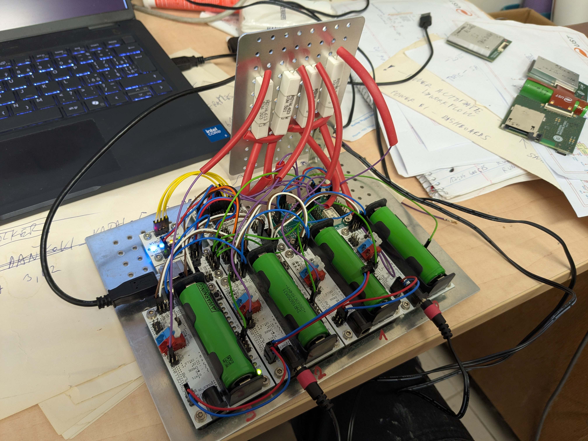

# LiIon4cycler

Li-ion cell tester for 4 cells at a time. It measures the capacity and the DC internal resistance of each cell and then brings the cells to a transport voltage. It is built from MLAB kit modules and is controlled from a Linux computer over USB.



## Hardware

```
 PC (Linux) ── USB
                │
        ┌───────┴────────┐  I²C (SV2)
        │   USBI2C01A    ├──────────────────┬───────────────────────────┐
        │   CP2112       │                  │                           │
        │ serial = ID    │          ┌───────┴────────┐          ┌───────┴─────────┐
        └───────┬────────┘          │   I2CPWM01A    │          │   I2CHUB02B     │
                │ GPIO3–6 (SV5)     │ PCA9531 @ 0x63 │          │ TCA9548A @ 0x73 │
                │                   └──┬─────────┬───┘          └─┬───┬───┬───┬───┘
                │           LED0–3 (L) │         │ LED4–7 (H)     │SV1│SV2│SV3│SV4 I²C ch0–3
                │              ┌───────┴──┐ ┌────┴─────────┐      │   │   │   │
                │              │ LED01A   │ │ 2× REL1SW01B │      │   │   │   │
                │              │ 4 LEDs   │ │ N-MOSFET     │      │   │   │   │
                │              └──────────┘ └────┬─────────┘      │   │   │   │
                │                         OUT1/2 │ load resistors │   │   │   │
                │ /CE (SV4)            ┌─────────┴────────────────┴───┴───┴───┴──┐
                └─────────────────────►│ 4× LION1CELL01B  (ch0 … ch3)            │◄── DC jack X2
                                       │ BQ24103 charger + BQ34Z100 gauge @ 0x55 │    on each board
                                       └─────────────────────────────────────────┘
```

| Cell channel | Charger /CE | Load (PCA9531) | Indicator LED |
|---|---|---|---|
| ch0 | GPIO6 | LED4 | LED0 |
| ch1 | GPIO5 | LED5 | LED1 |
| ch2 | GPIO4 | LED6 | LED2 |
| ch3 | GPIO3 | LED7 | LED3 |

- **Charging:** each cell has its own BQ24103 charger. The scripts switch it on and off through its /CE input. Without control from USB the chargers charge, because /CE has a pull-down. The charger's safety timer is disabled (TTC on GND); `cycling.py` limits the charge time instead. The charge current is set to about 350 mA by R19 and R18 = 30 kΩ; see the modifications in [POZNATKY.md](POZNATKY.md).
- **Discharging:** one resistive load per channel, switched statically by a PCA9531 output (L = off, H = on).
- **Measurement:** the BQ34Z100 gauge on each board measures voltage, current and temperature. Gauges with either of the two known firmware versions (0x0016 and 0x0006) are handled automatically.
- Several cyclers on one computer are told apart by the serial number of their CP2112.

### Wiring

Connector names (SV…, J…) are the designators from the module schematics in the [mlab-modules](https://github.com/mlab-modules) repositories. On the double-row MLAB headers both pins of a row are connected together; "row n" means pins 2n−1 and 2n. All modules share one GND.

**I²C bus** – USBI2C01A SV2 → I2CPWM01A J4 and I2CHUB02B (upstream port SV9, power SV10):

| Signal | USBI2C01A SV2 | I2CPWM01A J4 | I2CHUB02B |
|---|---|---|---|
| GND | row 1, 5 | row 1, 5 | SV10 row 1, 3 |
| SDA | row 2 | row 2 | SV9 row 2 |
| VDD | row 3 | row 3 | SV10 row 2 (VCC) |
| SCL | row 4 | row 4 | SV9 row 1 |

- VDD is the CP2112 I/O voltage: 3.3 V or 5 V, chosen by the jumper on USBI2C01A SV3.
- I2CPWM01A address 0x63: J1 (A0) and J2 (A1) open; A2 is tied to GND on the board.
- I2CHUB02B address 0x73: SV12 open (A0 = A1 = 1); A2 is tied to GND on the board.

**Gauges** – I2CHUB02B downstream port → LION1CELL01B SV3:

| Hub port (1×5) | LION1CELL01B SV3 (2×4) |
|---|---|
| pin 1 GND | row 4 GND |
| pin 2 SCn | row 2 SCL |
| pin 3 +V1 | not connected (the gauge is powered from the cell) |
| pin 4 SDn | row 1 SDA |
| pin 5 GND | row 4 GND |

SV3 row 3 (HDQ) is not used. The 10 kΩ pull-ups of SDn/SCn are on the hub.

**Charger enable** – USBI2C01A SV5 → LION1CELL01B SV4 row 4 (/CE). LION1CELL01B SV4 is: row 1 STAT1, row 2 PG, row 3 TTC, row 4 /CE, row 5 CELLS. /CE has a 10 kΩ pull-down (R11) on the board.

**Charger safety timer** – LION1CELL01B SV4 row 3 (TTC) is connected to GND (for example SV3 row 4) on every board. This disables the BQ24103 safety timer, which would otherwise stop a 350 mA charge after about 4.3 h. `cycling.py` switches the charger off through /CE after 16 h instead.

**Loads** – I2CPWM01A outputs LED4–LED7 drive the N-MOSFET inputs of two REL1SW01B modules.

- The PCA9531 outputs are open-drain. The 1 kΩ pull-up jumpers J10–J13 must be fitted, so a released output is H and the FET is on.
- The REL1SW01B gates have a pull-down, so a load is off when its input is not driven.
- REL1SW01B pins:
  - J1: row 1 IN2, row 2 IN1.
  - J2: row 1 OUT1, row 2 OUT2 (the FET drains).
  - J5: row 1 and row 4 GND (the FET sources), row 2 and row 3 VCC.
- The current path is: LION1CELL01B WAGO + (SV7, +BAT) → load resistor → REL1SW01B OUTx → FET → REL1SW01B GND (J5) → LION1CELL01B WAGO − (SV8, GND).
- The return current flows through the 10 mΩ shunt of the gauge (R2, between the cell − and GND), so the gauge measures the discharge current.
- VCC on J5 only feeds the free-wheel diodes and is not needed with resistive loads.

**Indicator LEDs** – LED01A, wired with common anodes:

- Jumpers are fitted on SV2 (anode rail to the series resistors). SV1 has no jumpers.
- The anode rail (SV3 pin 2) goes to I2CPWM01A VDD (J3 row 2).
- The cathodes on LED01A SV1 (pin 7 = D1, 5 = D2, 3 = D3, 1 = D4) go to the I2CPWM01A outputs LED0–LED3. A LED lights when its output is L.
- I2CPWM01A pull-up jumpers J6–J9 are not needed, because LED01A has its own resistors.

**Per channel:**

| Channel | Hub port | /CE: USBI2C01A SV5 → LION1CELL01B SV4 | Load: I2CPWM01A output (pull-up) → REL1SW01B | Indicator: I2CPWM01A output → LED01A |
|---|---|---|---|---|
| ch0 | SV1 | row 4 (GPIO6) → row 4 | LED4 J18 (J10) → #1 IN1, OUT1 | LED0 J14 → D1 |
| ch1 | SV2 | row 3 (GPIO5) → row 4 | LED5 J19 (J11) → #1 IN2, OUT2 | LED1 J15 → D2 |
| ch2 | SV3 | row 2 (GPIO4) → row 4 | LED6 J20 (J12) → #2 IN1, OUT1 | LED2 J16 → D3 |
| ch3 | SV4 | row 1 (GPIO3) → row 4 | LED7 J21 (J13) → #2 IN2, OUT2 | LED3 J17 → D4 |

USBI2C01A SV5 row 5 (GPIO7) is not used. The USBI2C01A TX/RX LEDs (GPIO0/GPIO1) blink during `hwtest.py`.

**Power:**

| Module | Supply |
|---|---|
| USBI2C01A | USB |
| I2CPWM01A, I2CHUB02B | VDD from USBI2C01A SV2 |
| LED01A | VDD from I2CPWM01A J3 |
| LION1CELL01B | Own adapter in the DC jack X2 on each board; SV1 row 2 is the same input. The gauge and the board logic run from the cell. |

Details and findings from bring-up are in [POZNATKY.md](POZNATKY.md) (Czech). Open work is in [TODO.md](TODO.md).

## Requirements

- Linux with the `hid_cp2112` driver, which is part of the standard kernel.
- Python 3; no extra packages are needed, except `matplotlib` for `plotlog.py`.
- Read/write access to the converter's `/dev/i2c-*` and `/dev/hidraw*`. On a new computer, run `./setup_permissions.sh` once (it asks for the sudo password). The script installs a udev rule for USB ID `10c4:ea90` (group `plugdev`), loads `i2c-dev` at boot and adds you to the group `plugdev`. Then log out and in again and reconnect the cycler; after that the scripts run without sudo.

## Scripts

| Script | Purpose |
|---|---|
| `hwtest.py` | Hardware test and shared library. Blinks the LEDs, finds the gauges, identifies their firmware, loads the matching configuration and prints the readings. |
| `setup_permissions.sh` | One-time setup of a new computer: access to the CP2112 without sudo. |
| `alloff.py` | Puts the cycler into a safe state with all chargers and loads off. |
| `chargertest.py` | Checks the charger /CE wiring; with `--loads` it also checks the loads. |
| `monitor.py` | Reads the raw gauge values (no calibration), with chargers and loads off. Optional CSV log. |
| `cycling.py` | Cell test: discharge → charge → discharge → charge to 3.5 V. Writes capacity and DC resistance to `results.csv`. |
| `transport.py` | Charges or discharges the cells to the 3.5 V open-circuit transport voltage. |
| `plotlog.py` | Live plot of voltage, current and resistance from a running log. |

Every script has `--help`. Only one script can use a cycler at a time; a second one refuses to start.

## Test procedure

1. **Check the hardware** after assembly or after replacing a board. The output should end with `RESULT: all OK`.
   ```
   ./hwtest.py
   ```
2. **Switch everything off** before connecting power supplies and cells:
   ```
   ./alloff.py
   ```
3. **Insert the cells and start the test.** Cell labels are optional:
   ```
   ./cycling.py --cells A1,A2,A3,A4
   ```
   - **Do not touch the cells or their holders while the test is running.** Moving a cell changes the contact resistance of the holder, which changes the measured internal resistance and affects the capacity measurement.
   - Each cell goes through these steps:
     1. Discharge to 3.5 V under load, then rest 10 min.
     2. Charge to full, then rest 30 min.
     3. Discharge to 2.8 V under load. The capacity (mAh, Wh) comes from this discharge.
     4. Rest 10 min. The voltage recovery is only logged and is not used for any result.
     5. Charge until the voltage under charge reaches 3.5 V, then the test ends. The resulting voltage is not checked; `transport.py` sets the exact transport voltage.
   - The DC internal resistance is measured every 5 min during both discharges: the load is switched off for 3 s and R = ΔU / ΔI between the reading just before and the reading 3 s after switching off. The result is the median of the values from the capacity discharge.
   - At start, the gauge configuration is checked and the values the gauge learned on the previous cells are discarded. Use `--same-cells` to keep them when you continue with the same cells.
   - `--skip-predischarge` skips the initial discharge and its rest; the test starts with charging.
   - More options: `--empty-pre MV` (initial discharge end, default 3500), `--empty MV` (capacity discharge end, default 2800), `--rest-after MIN` (recovery logging, default 10), `--final MV` (final charge end, default 3500), `--rest MIN`, `--rest-empty MIN`, `--rint MIN` (R period), `--rint-off S` (load off time for R, default 3).
4. **Watch the progress** in a second terminal. Without an argument it opens the newest log:
   ```
   ./plotlog.py
   ```
5. **Results:** `results.csv` gets one row per cell and test. Each row holds:
   - capacity and energy, and the capacity discharge end voltage (`empty_mV`);
   - DC resistance (median, min, max) and the load off time used (`R_pulse_s`);
   - discharge current;
   - voltage after charge and charged capacity;
   - maximum temperature;
   - the cycler serial and the status: `OK`, `ABORTED in …`, or `OK, ABORTED in REST3/CHARGE3` when the run was stopped after the capacity was already measured;
   - whether a calibration was used (`calibrated`).

   The file is only ever appended to, never overwritten.
6. **Prepare the cells for transport.** `cycling.py` leaves the cells charged to about 3.5 V under charge, so their open-circuit voltage is somewhat lower. `transport.py` sets each cell exactly to 3.5 V open-circuit:
   ```
   ./transport.py
   ```
   Then disconnect the cells first and USB second. Without USB the chargers switch on by themselves.

For a quick look at the cells without changing anything, use `./cycling.py --status`. For continuous readings, use `./monitor.py`.

## Calibration

Voltage and current readings are corrected per cycler and channel from `calibration.csv` (next to the scripts). There is one line per channel; the cycler is identified by its CP2112 serial number:

```
cycler,ch,U_gain,U_offset_mV,I_gain,I_offset_mA,date,note
00A59BFD,0,1.001184,0,0.963687,0,2026-11-08,"UNI-T UT804: 3.715 V -> 3.7194 V, 1.432 A -> 1.380 A (discharge)"
```

- Corrected value = gauge value × gain + offset (mV, mA). Lines starting with `#` are comments.
- With one calibration point: gain = meter reading / gauge reading, offset = 0.
- A channel without a line uses the gauge values as they are. The scripts print at start which channels are calibrated.
- `cycling.py` and `transport.py` display and log calibrated values. The log column `cal` (1/0) shows whether calibration was used; `results.csv` has the column `calibrated`.
- `hwtest.py` and `monitor.py` show raw gauge values, for comparison with a reference meter.

## Several cyclers on one computer

```
./hwtest.py --list                    # serial numbers of connected CP2112 converters
./hwtest.py --cycler 9BFD             # test one cycler (its TX/RX LEDs blink)
./cycling.py --cycler 9BFD --cells …  # a unique end of the serial number is enough
CYCLER=9BFD ./monitor.py              # same, via environment variable
./alloff.py --all                     # switch off every cycler that is not in use
```

Log names contain the serial number, for example `cycling_00A59BFD_20261108_125405.csv`. All cyclers write to the same `results.csv`; the `cycler` column tells the rows apart.

## Logs

| File | Content |
|---|---|
| `cycling_<serial>_<date>.csv` | Every reading of every cell: state, load, U, I, T, SoC, R. |
| `transport_<serial>_<date>.csv` | Progress of `transport.py`, same columns. |
| `monitor_<serial>_<date>.csv` | Log of `monitor.py --log`. |
| `results.csv` | Summary results of the tests. |
| `calibration.csv` | Calibration per cycler and channel (configuration, kept in git). |
